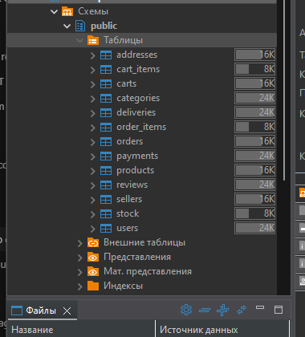
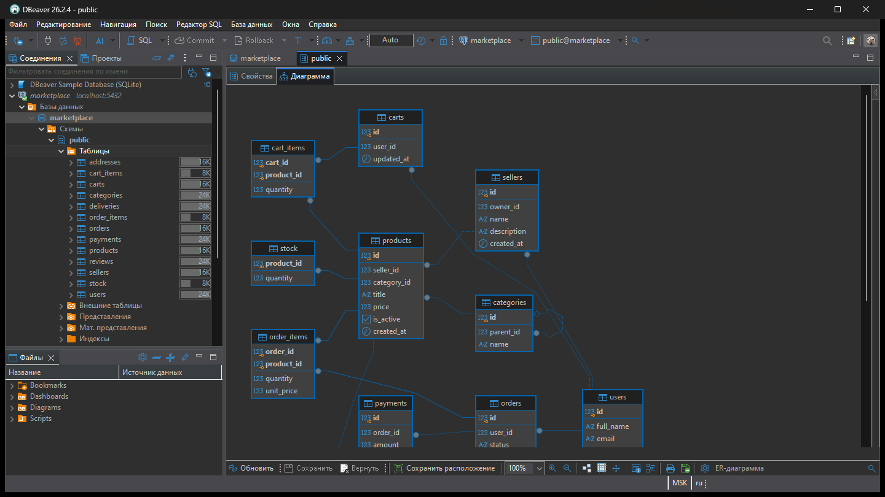
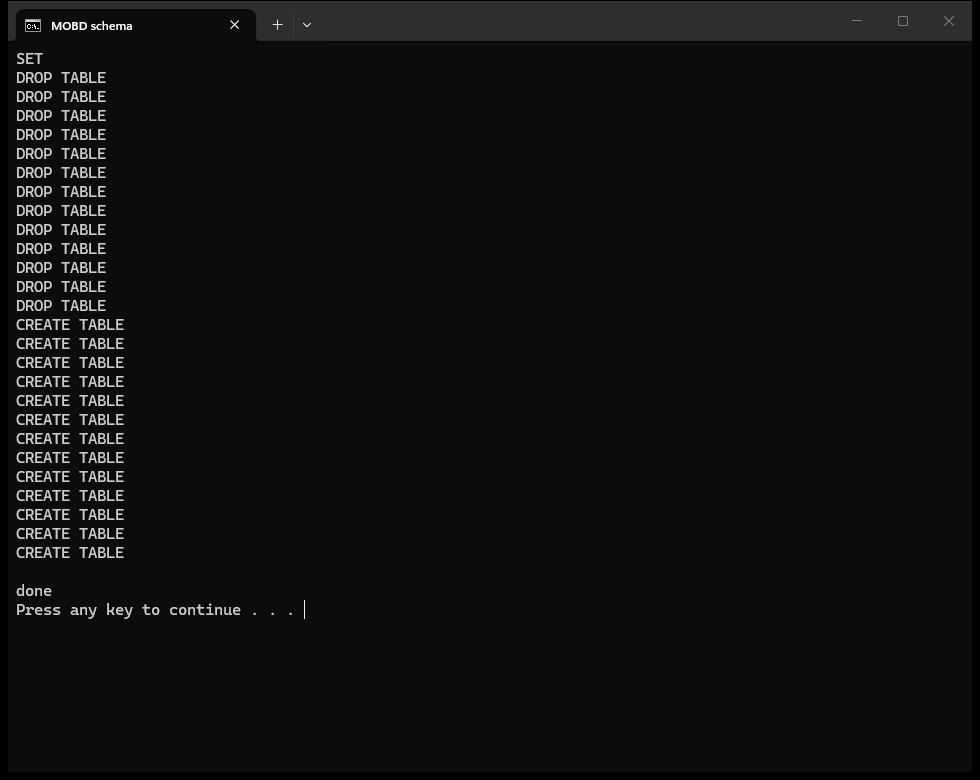
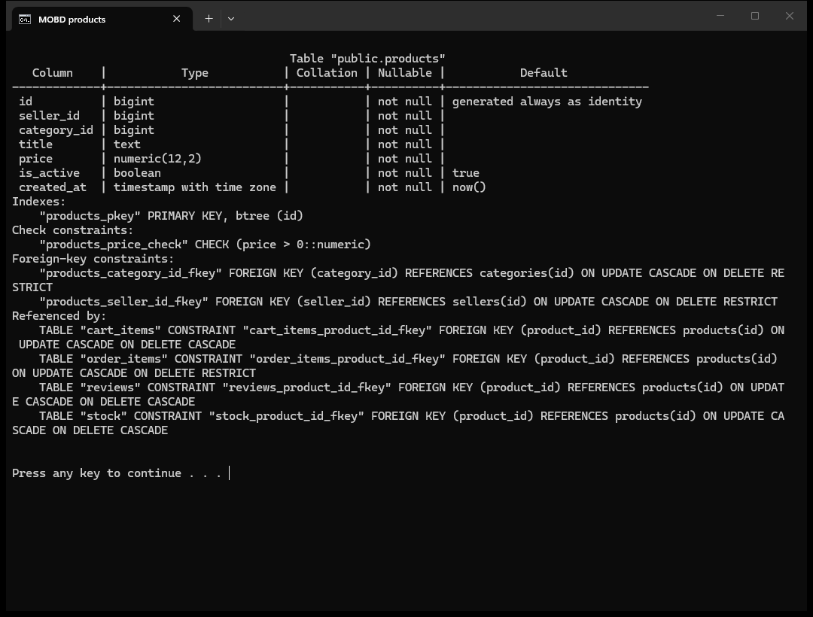

# Лабораторная работа 1

Проектирование и создание структуры базы данных

Выполнил: Самир Альхну

База данных маркетплейса. Пользователь регистрируется и может открыть магазин, чтобы размещать товары. Товары относятся к категориям, категории могут быть вложенными. Покупатель собирает корзину, оформляет заказ, оплачивает его, после чего заказ доставляется на адрес. На товар можно оставить отзыв.

Работа выполнена в PostgreSQL 18, схема просматривалась в DBeaver. Файл `schema.sql` при повторном запуске сначала удаляет таблицы и создаёт их заново.

## Правила

У товара один продавец и одна категория. У корневой категории `parent_id` пустой, остальные ссылаются на родительскую. Заказ принадлежит одному покупателю. Один и тот же товар нельзя добавить в заказ второй строкой: первичный ключ `(order_id, product_id)`. В строке хранятся количество и цена на момент покупки. Если продавец позже изменит цену в карточке, оформленные заказы не пересчитываются.

Отзыв оставляет один пользователь на один товар. Повторная запись той же пары запрещена ограничением `unique (user_id, product_id)`. Оценка от 1 до 5. Цена больше нуля, остаток на складе не отрицательный. У пользователя одна корзина: на `carts.user_id` стоит `unique`.

Связь «многие-ко-многим» реализована таблицами `order_items` и `cart_items`. Иерархия категорий задаётся столбцом `parent_id` в `categories`: это внешний ключ на ту же таблицу.

Пустой заказ без позиций нельзя запретить одним `check`, потому что позиции хранятся в другой таблице. Такая проверка относится к оформлению заказа и в этой работе не делается. Товар при этом нельзя удалить из истории: пока он есть в `order_items`, карточку удалить нельзя.

## Про 3НФ
3НФ - таблица находится во 2НФ, и в ней нет транзитивных зависимостей неключевых столбцов от первичного ключа.
Если в `products` вместе с товаром хранить название магазина и почту продавца, в таблице появляется избыточность. При смене почты пришлось бы обновлять все товары продавца: пропущенная строка оставит в базе разные адреса. Удаление последнего товара продавца удалит и сведения о магазине. Продавца без товаров добавить нельзя. Это аномалии обновления, удаления и вставки.

Данные магазина вынесены в `sellers`, в товаре остаётся только `seller_id`. Название категории в товаре не хранится, только `category_id`. Поля товара зависят от его `id`, а не от другого описательного поля. В `order_items` количество и цена зависят от всей пары `(order_id, product_id)`, а не от её части. Это третья нормальная форма.

`unit_price` в позиции заказа не является копией текущей цены товара. Это цена, по которой товар был куплен.

## Ключи

Первичный ключ везде суррогатный: `id bigint generated always as identity`. Почта не используется как первичный ключ, потому что её можно изменить, а на пользователя уже ссылаются заказы, отзывы и магазин. Уникальность почты задаёт ограничение `unique`.

У `order_items` и `cart_items` отдельный `id` не используется. Строку однозначно определяет пара внешних ключей, она и выбрана первичным ключом. У склада первичный ключ — `product_id`: на один товар приходится один остаток.

На внешних ключах указано `on update cascade`. Значение `id` не изменяется, но если его всё же обновить, связанные ссылки тоже обновятся.

Правила удаления:

- при удалении заказа его позиции удаляются каскадом, отдельно от заказа они не хранятся;
- товар, который уже входит в заказ, удалить нельзя (`restrict`), иначе потеряется состав покупки;
- при удалении карточки товар убирается из корзины: корзина не хранит историю покупок;
- категорию с вложенными категориями или товарами удалить нельзя;
- пользователя с магазином или заказами удалить нельзя;
- адреса, корзина и отзывы удаляются вместе с пользователем.

## Словарь данных

### users

Учётная запись. Покупатель и владелец магазина — один и тот же человек, отдельной роли нет: если есть строка в `sellers`, значит открыл магазин.

| столбец | тип | ограничения | назначение |
|---|---|---|---|
| id | bigint | pk, identity | номер |
| full_name | text | not null | имя |
| email | text | not null, unique | почта |
| phone | text | | телефон, необязательный |
| created_at | timestamptz | not null, default now() | когда создан |

### addresses

Адреса доставки пользователя. Их может быть несколько.

| столбец | тип | ограничения | назначение |
|---|---|---|---|
| id | bigint | pk, identity | номер |
| user_id | bigint | not null, fk → users, on delete cascade | владелец адреса |
| city | text | not null | город |
| street | text | not null | улица |
| building | text | not null | дом |
| apartment | text | | квартира |
| is_default | boolean | not null, default false | адрес по умолчанию |

### sellers

Магазин. Владелец — пользователь.

| столбец | тип | ограничения | назначение |
|---|---|---|---|
| id | bigint | pk, identity | номер |
| owner_id | bigint | not null, fk → users, on delete restrict | владелец |
| name | text | not null | название |
| description | text | | описание, необязательное |
| created_at | timestamptz | not null, default now() | когда открыт |

### categories

Дерево категорий. `parent_id` ссылается на эту же таблицу.

| столбец | тип | ограничения | назначение |
|---|---|---|---|
| id | bigint | pk, identity | номер |
| parent_id | bigint | fk → categories, on delete restrict | родительская категория, у корня null |
| name | text | not null, unique | название |

### products

Карточка товара.

| столбец | тип | ограничения | назначение |
|---|---|---|---|
| id | bigint | pk, identity | номер |
| seller_id | bigint | not null, fk → sellers, on delete restrict | магазин |
| category_id | bigint | not null, fk → categories, on delete restrict | категория |
| title | text | not null | название |
| price | numeric(12,2) | not null, check > 0 | цена |
| is_active | boolean | not null, default true | признак отображения в каталоге |
| created_at | timestamptz | not null, default now() | когда добавлен |

### stock

Сколько штук можно продать. Одна строка на товар.

| столбец | тип | ограничения | назначение |
|---|---|---|---|
| product_id | bigint | pk, fk → products, on delete cascade | товар |
| quantity | integer | not null, check >= 0 | остаток |

### carts

Текущая корзина. У пользователя одна.

| столбец | тип | ограничения | назначение |
|---|---|---|---|
| id | bigint | pk, identity | номер |
| user_id | bigint | not null, unique, fk → users, on delete cascade | владелец корзины |
| updated_at | timestamptz | not null, default now() | время последнего изменения |

### cart_items

Состав корзины. Многие-ко-многим между корзиной и товарами.

| столбец | тип | ограничения | назначение |
|---|---|---|---|
| cart_id | bigint | pk, fk → carts, on delete cascade | корзина |
| product_id | bigint | pk, fk → products, on delete cascade | товар |
| quantity | integer | not null, check > 0 | количество |

### orders

Заказ покупателя.

| столбец | тип | ограничения | назначение |
|---|---|---|---|
| id | bigint | pk, identity | номер |
| user_id | bigint | not null, fk → users, on delete restrict | покупатель |
| status | text | not null, default new, check по списку статусов | new, paid, shipped, delivered, cancelled |
| created_at | timestamptz | not null, default now() | когда оформлен |

### order_items

Состав заказа. Многие-ко-многим между заказами и товарами.

| столбец | тип | ограничения | назначение |
|---|---|---|---|
| order_id | bigint | pk, fk → orders, on delete cascade | заказ |
| product_id | bigint | pk, fk → products, on delete restrict | товар |
| quantity | integer | not null, check > 0 | количество |
| unit_price | numeric(12,2) | not null, check > 0 | цена на момент покупки |

### payments

Оплата заказа. На заказ одна запись.

| столбец | тип | ограничения | назначение |
|---|---|---|---|
| id | bigint | pk, identity | номер |
| order_id | bigint | not null, unique, fk → orders, on delete restrict | оплачиваемый заказ |
| amount | numeric(12,2) | not null, check > 0 | сумма |
| status | text | not null, default pending, check по списку | pending, paid, failed, refunded |
| paid_at | timestamptz | | время оплаты, до оплаты null |

### reviews

Отзыв на товар.

| столбец | тип | ограничения | назначение |
|---|---|---|---|
| id | bigint | pk, identity | номер |
| user_id | bigint | not null, fk → users, on delete cascade | автор отзыва |
| product_id | bigint | not null, fk → products, on delete cascade | товар |
| score | smallint | not null, check от 1 до 5 | оценка |
| comment | text | | текст отзыва, необязательный |
| created_at | timestamptz | not null, default now() | когда |
| | | unique (user_id, product_id) | один отзыв пользователя на товар |

### deliveries

Доставка заказа на конкретный адрес. У заказа одна доставка.

| столбец | тип | ограничения | назначение |
|---|---|---|---|
| id | bigint | pk, identity | номер |
| order_id | bigint | not null, unique, fk → orders, on delete cascade | заказ |
| address_id | bigint | not null, fk → addresses, on delete restrict | адрес доставки |
| status | text | not null, default pending, check по списку | pending, shipped, delivered, cancelled |
| tracking_code | text | | номер отслеживания, может отсутствовать |

## Что получилось в базе

База называется `marketplace`. Дерево таблиц и диаграмма получены в DBeaver, скрипт выполнен в psql. Повторный запуск проходит успешно: сначала `drop`, затем снова `create`.

Таблицы в DBeaver, схема `public`:

Диаграмма оттуда же, вкладка «Диаграмма»:

Вывод скрипта:

`\d products`. Видно identity, check на цену и внешние ключи:

